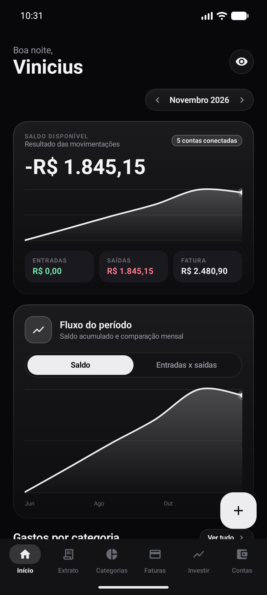
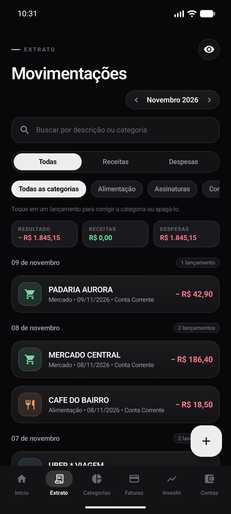
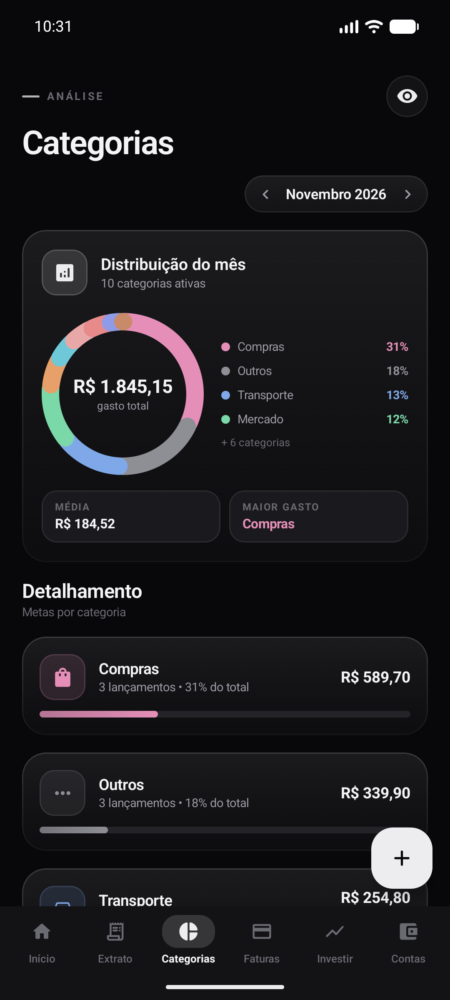
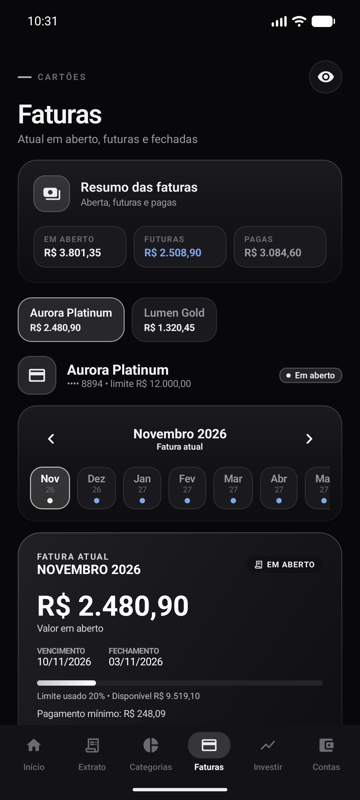
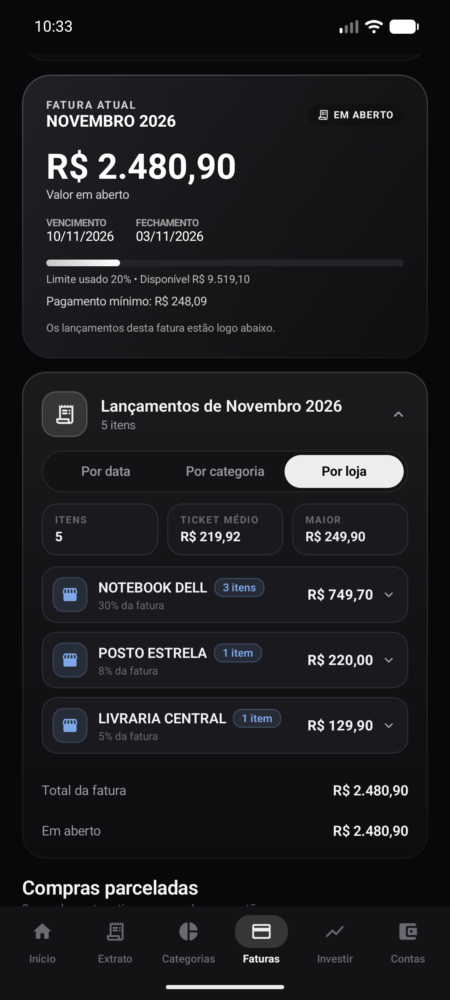
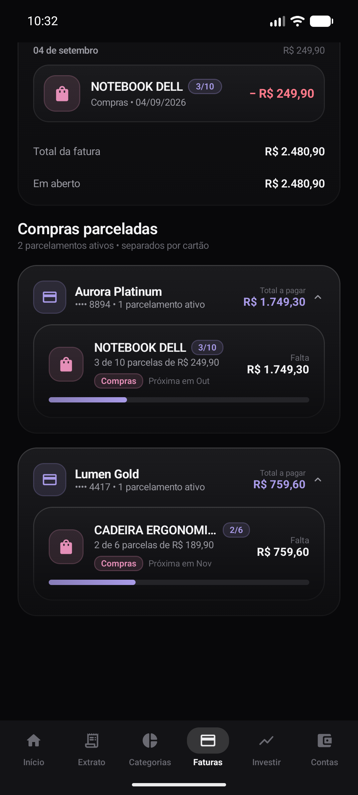
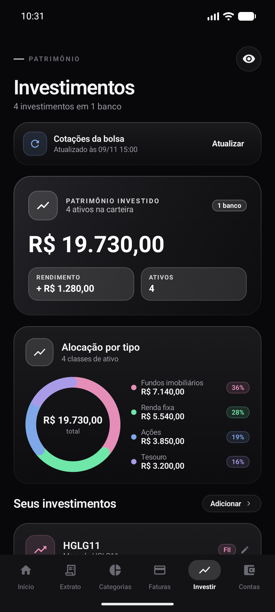
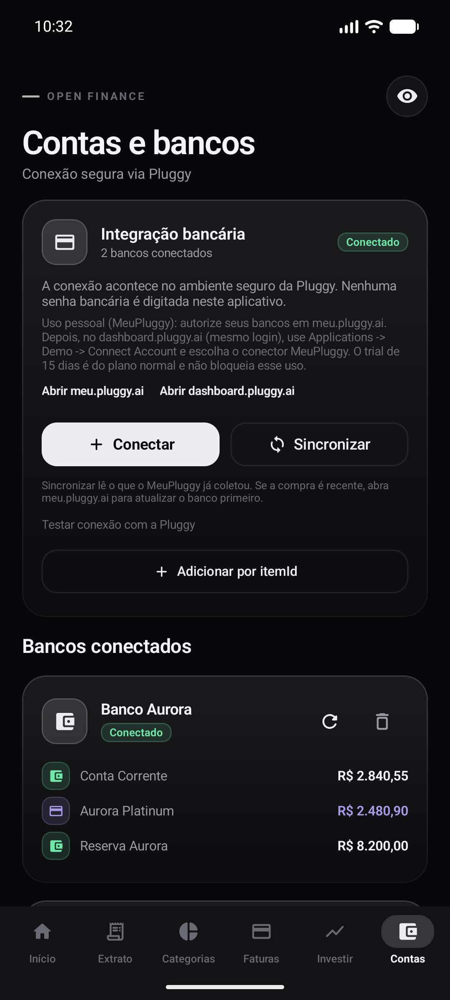
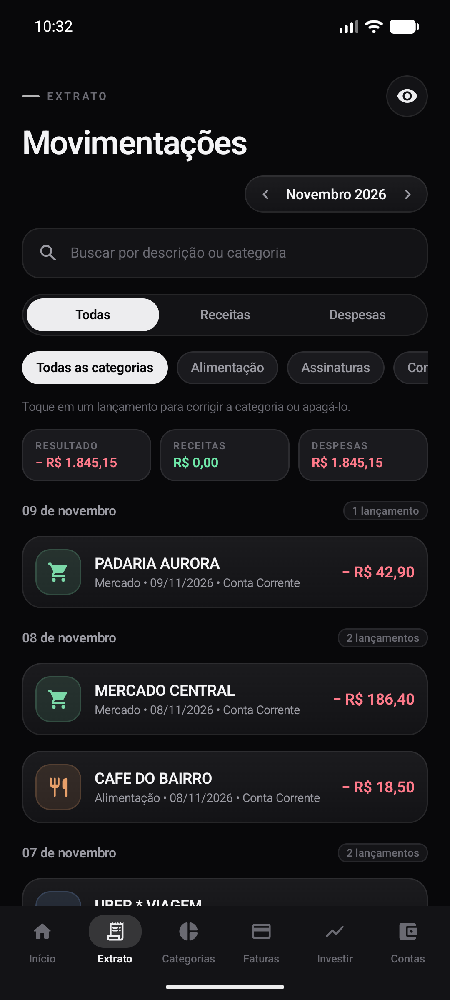

# Meu Financeiro

Aplicativo Android nativo em **Kotlin + Jetpack Compose**, com tema escuro, interface em português e armazenamento **100% local** (sem backend, sem login, sem nuvem). Importa contas, cartões, faturas, investimentos e transações via **Open Finance (Pluggy)** e monta uma visão consolidada do seu dinheiro: extrato, categorias, faturas de cartão, carteira de investimentos e cotação de ações.

> **Sobre as imagens:** todos os prints deste README usam **dados fictícios** (os bancos "Banco Aurora" e "Banco Lumen", por exemplo, são inventados). Nenhum dado real aparece aqui.

---

## Telas

| | |
|---|---|
|  |  |
| **Início** — saldo do mês, entradas/saídas, fatura atual e fluxo acumulado | **Movimentações** — busca, filtros e correção de categoria por toque |
|  |  |
| **Categorias** — rosca do mês, participação por categoria e orçamento mensal | **Faturas** — alterna entre os cartões; fatura em aberto, futuras e pagas |
|  |  |
| **Faturas por loja** — a fatura agrupada por estabelecimento, não linha a linha | **Compras parceladas** — só as que ainda estão em aberto, separadas por cartão |
|  |  |
| **Investir** — patrimônio, alocação por tipo e cotação de ações | **Contas** — conexões Open Finance, diagnóstico e biometria |
|  | |
| **Reclassificar** — a categoria do banco nem sempre está certa; um toque resolve | |

---

## Recursos

### Início
Saldo disponível do mês (resultado das movimentações), entradas, saídas e o valor da fatura em aberto, com o gráfico do fluxo acumulado dos últimos 6 meses. Abaixo: gastos por categoria, cartões de fatura, orçamentos e as últimas movimentações. Um toque no olho oculta todos os valores na hora (ideal para mostrar o app na rua).

### Movimentações (extrato)
Busca por descrição ou categoria, filtro por tipo (todas / receitas / despesas) e por categoria, agrupamento por dia. **Toque em um lançamento** para abrir o editor de categoria, aplicar a mesma regra a todos os lançamentos daquele estabelecimento ou apagar o lançamento.

### Categorias
Gráfico de rosca do mês, detalhamento por categoria com percentual do total e **orçamento mensal por categoria** (com alerta quando passa do limite). Aqui também ficam as **regras de categoria** que você criou: dá para ver e apagar cada uma.

### Faturas
- Um cartão por vez, com seletor no topo mostrando o valor em aberto de cada um
- Faixa de meses com o status de cada fatura (aberta, futura, vencida, paga)
- Card principal com valor em aberto, vencimento, fechamento, limite usado e pagamento mínimo
- **Três formas de ver os lançamentos**: por data, por categoria e **por loja** (a que resolve a "listagem gigante")
- Resumo: total em aberto, futuras e pagas de todos os cartões
- **Compras parceladas em aberto**, separadas por cartão, com categoria e mês da próxima parcela

### Investir
Patrimônio total, rendimento, alocação por tipo em rosca e um card por ativo. Aceita **ações, FIIs e ETFs** com código, quantidade de cotas e preço médio — o saldo é calculado a partir disso. Tem **cotação automática** da bolsa (brapi.dev, com fallback para o Yahoo Finance).

### Contas
Conexão de bancos via Pluggy (widget do navegador), sincronização, atualização e desconexão, diagnóstico da conexão, nome do dono (para reconhecer PIX entre as suas contas) e **desbloqueio por biometria**.

---

## Requisitos

- Android Studio (Giraffe ou superior)
- JDK 17
- Android SDK Platform 35 e Build Tools
- Gradle 8.9+ (o projeto já traz o wrapper)

`minSdk 26` · `targetSdk 35` · `compileSdk 35`

---

## Configuração

Crie/edite o `local.properties` na raiz do projeto (**não versionado**):

```properties
sdk.dir=C:\caminho\para\o\Android\Sdk

# Open Finance (Pluggy)
pluggy.clientId=SEU_CLIENT_ID
pluggy.clientSecret=SEU_CLIENT_SECRET
pluggy.apiBaseUrl=https://api.pluggy.ai

# Cotação de ações (brapi.dev) - opcional
# Sem a chave o app ainda funciona: usa a brapi sem chave e cai no Yahoo Finance.
brapi.token=SUA_CHAVE_BRAPI
```

> O app gera o *Connect Token* em tempo de execução a partir dessas credenciais (uso pessoal). **Em produção, gere o token em um backend e nunca embuta o `clientSecret` no APK.**

A chave da brapi é gratuita (15.000 requisições/mês) em [brapi.dev](https://brapi.dev). Sem ela, o app usa a brapi sem chave e, se ela recusar, cai automaticamente no Yahoo Finance.

---

## Compilar e instalar

```bash
# compilar
gradlew.bat :app:assembleDebug      # Windows
./gradlew :app:assembleDebug        # Linux/macOS

# instalar no aparelho
adb install -r app\build\outputs\apk\debug\app-debug.apk
```

APK gerado em `app/build/outputs/apk/debug/app-debug.apk`.

---

## Conectar um banco

1. **Contas → Conectar**. O widget da Pluggy abre no navegador do sistema.
2. Aceite os termos, escolha a instituição e faça login.
3. Se o banco exigir OAuth, o app volta sozinho pelo deep link `meufinanceiro://pluggy-callback`.
4. Ao concluir, o app sincroniza contas, cartões, faturas, investimentos e transações.
5. Para outro banco, use **Conectar outro banco**.

### Uso pessoal sem plano pago (MeuPluggy)

O plano trial da Pluggy não cria conexões com bancos reais. O caminho gratuito é o conector **MeuPluggy**:

1. Crie sua conta em [meu.pluggy.ai](https://meu.pluggy.ai) e conecte cada banco por lá.
2. No Dashboard da Pluggy: **Customization → Connectors → Direct Connectors → Personal → MeuPluggy**.
3. No app: **Contas → Já conectou no MeuPluggy? Adicionar por itemId**.
4. Copie o `itemId` em **Dashboard → Applications → Demo → Connected Items** e cole no app. Repita para cada banco.

A autorização do MeuPluggy dura 1 ano. A API não permite listar itens (`GET /v2/items` devolve 403), por isso os `itemId`s ficam salvos localmente e cada banco precisa ser adicionado uma vez.

---

## Como funciona por dentro

### Classificação automática dos lançamentos

O banco quase nunca acerta a categoria. O app classifica em três níveis, do mais forte para o mais fraco:

1. **Estabelecimento** — regras por nome de loja (`POSTO ITRELA` → Transporte, `PRATINHO DA MADRUGADA` → Alimentação).
2. **Categoria do banco** — quando o Open Finance devolve algo útil (`groceries`, `transport`...).
3. **Palavras-chave da descrição** — último recurso antes de "Outros".

A categoria crua do banco fica guardada, então **melhorar uma regra reclassifica todo o histórico na hora**, sem sincronizar. Você ainda pode sobrescrever qualquer lançamento na mão, e essa escolha sobrevive às próximas sincronizações.

### Faturas: em aberto, futuras, pagas e projeções

A Open Finance não padroniza onde o pagamento da fatura é registrado: alguns bancos o registram na própria fatura e outros na seguinte. O app **detecta a convenção do banco** e aceita as duas, evitando o falso positivo de dar a fatura anterior como paga.

- **Em aberto** — a fatura não paga mais recente
- **Futura** — ainda não fechou, vencimento à frente
- **Vencida** — o vencimento passou e não foi paga
- **Paga** — o total foi coberto pelo pagamento registrado nela ou na seguinte
- **Projeção** — quando o banco não devolve uma fatura futura em `/bills`, o app recupera as faturas citadas nos lançamentos via `/bills/{id}` e, se ainda não existirem, projeta o mês a partir das compras e parcelas futuras

Projeções **não são persistidas**: são recalculadas a cada sincronização. Um mês aparece **uma única vez** na faixa, mesmo quando o banco devolve a fatura do mês aberto ainda vazia.

### Parcelamentos: só os que estão em aberto

Nem todo parcelamento com parcelas faltando continua em aberto. Quando a compra é quitada de uma vez (antecipadamente) ou cancelada, o banco para de devolver as parcelas restantes — mas o `totalInstallments` continua lá, e o parcelamento apareceria como ativo para sempre.

O app usa a **fatura como prova**: se todas as parcelas já caíram em faturas pagas, o parcelamento acabou. Compras iguais do mesmo lojista em preços diferentes também são separadas (o valor entra na chave de agrupamento), e compras estornadas saem da lista.

### Cotações de ações

Duas fontes, nesta ordem:

1. **brapi.dev** — API brasileira, ticker nativo (`PETR4`), dados ricos (market cap, mínimo/máximo de 52 semanas). Com chave gratuita: 15.000 requisições/mês
2. **Yahoo Finance** — sem chave nenhuma, aceita vários tickers por chamada, exige o sufixo `.SA`

O botão **Atualizar** busca as cotações e recalcula o valor de mercado das posições (cotas × cotação) e o rendimento. Só posições com **código e quantidade de cotas** são atualizadas: quem cadastrou um saldo manual nunca tem o valor sobrescrito pela bolsa.

---

## Armazenamento local

Tudo fica em `SharedPreferences` (preferência `private_finance`), em JSON:

| Chave | Conteúdo |
|---|---|
| `movements` | lançamentos (com a categoria crua do banco) |
| `accounts` | contas e cartões |
| `bills` | faturas |
| `investments` | investimentos, ações e caixinhas |
| `budgets` | orçamento por categoria |
| `category_overrides` | regras de categoria por estabelecimento |
| `manual_categories` | categorias escolhidas à mão por lançamento |
| `pluggy_items` | conexões Pluggy (`itemId`s) |

Um dado corrompido **não derruba o app**: o JSON inválido é tratado como lista vazia.

---

## Estrutura do projeto

```
app/src/main/java/br/com/meufinanceiro/
├── MainActivity.kt          activity, biometria e deep link da Pluggy
├── data/                    modelo, persistência e regras de negócio
│   ├── Models.kt            Movement, FinanceAccount, CreditBill, Investment
│   ├── FinanceCalculator.kt faturas, parcelamentos, categorias, gráficos
│   ├── CategoryClassifier.kt classificação automática dos lançamentos
│   ├── CategoryRules.kt     regras do usuário por lançamento/estabelecimento
│   ├── QuoteService.kt      cotações (brapi + Yahoo)
│   ├── StockQuote.kt        modelo da cotação
│   ├── TransferDetector.kt  PIX entre as suas próprias contas
│   └── LocalStore.kt        persistência em SharedPreferences
├── pluggy/                  integração Open Finance (cliente, modelos, repositório, widget)
└── ui/
    ├── FinanceApp.kt        navegação por abas
    ├── AppViewModel.kt      estado e ações da tela
    ├── theme/               cores, tipografia e estilo por categoria
    ├── components/          cards, gráficos, chips e diálogos reaproveitados
    └── screens/             Início, Extrato, Categorias, Faturas, Investir, Contas
```

---

## Testes

```bash
gradlew.bat :app:testDebugUnitTest
```

**82 testes** cobrindo o que é fácil quebrar:

| Arquivo | O que garante |
|---|---|
| `FinanceCalculatorTest` | classificação das faturas (aberta, futura, vencida, paga) e projeção de meses |
| `RealDataRegressionTest` | os números de uma fatura real de referência |
| `RealDataCategoryTest` | a cobertura da classificação automática nos dados reais |
| `CategoryClassifierTest` | as regras por estabelecimento |
| `CategoryRulesTest` | a prioridade entre escolha do usuário e regra automática |
| `InstallmentPlanTest` | compras parceladas do mesmo lojista não se misturam |
| `InstallmentSettlementTest` | parcelamento quitado não aparece como ativo |
| `InvoiceMonthDuplicationTest` | um mês aparece uma única vez na faixa de faturas |
| `AccountKindTest` | pseudo-contas e produtos de investimento não contam como conta |
| `StockQuoteTest` | leitura das cotações (brapi e Yahoo) |
| `TransferDetectorTest` | PIX entre as suas contas não entra como despesa |
| `PluggyModelsTest` | sinal e status das transações do Open Finance |

---

## Segurança e privacidade

- `local.properties` **não deve ser versionado** (já está no `.gitignore`).
- Os valores podem ser ocultados a qualquer momento pelo ícone de olho.
- Biometria opcional para abrir o app (e para ligá-la/desligá-la).
- Com a biometria ativa, o app usa `FLAG_SECURE`: a tela não aparece na visão de multitarefa.
- O `clientSecret` usado em desenvolvimento foi exposto e deve ser **rotacionado** no painel da Pluggy.
- Para distribuição real, mova a geração do *Connect Token* para um backend.

---

## Limitações

- Uso pessoal: não há sincronização entre dispositivos.
- A sincronização depende da disponibilidade da API da Pluggy.
- Itens removidos no banco podem reaparecer em uma nova sincronização.
- Nem todo banco informa rendimento ou data de vencimento dos investimentos via Open Finance (nesse caso o app oculta o rendimento em vez de mostrar valor errado).
- As cotações do plano gratuito da brapi são atualizadas a cada 30 minutos.
- Nenhum dado sai do aparelho, exceto as consultas ao Open Finance e à API de cotações.

---

## Licença

Uso pessoal. O código é aberto para estudo e adaptação.
